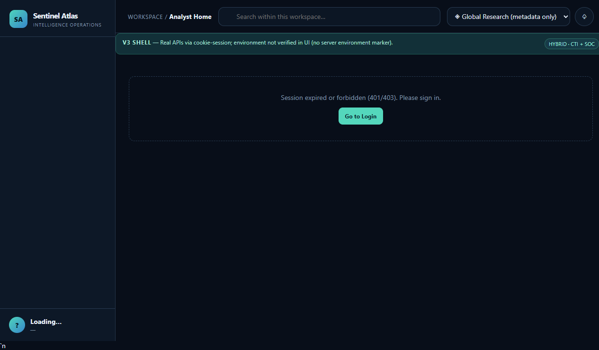

# Sentinel Atlas v3 browser smoke test

## Verdict: ENVIRONMENT / NOT VERIFIED

Executed 2026-11-17 around 16:18 UTC on Windows, installed Vercel Labs agent-browser 0.41.2. Target: http://127.0.0.1:4173/index.html. Repository baseline: 32a842113c38e6d647422c34d8708cec5aeb3fa2. The served source revision was not independently attested. This report verifies the observed page only; it does not certify a release.

The page loaded its v3 shell but entered the session-denied state. Analyst Home panels and research navigation were unavailable. The minimum authenticated smoke flow is NOT VERIFIED. Missing static assets/session are environment blockers here, not established product FAIL. No credentials were requested or fabricated and no authentication bypass or mocked backend was used.

## Skill and execution surface

Created and enabled the requested `agent-browser` skill from https://github.com/vercel-labs/agent-browser, then followed the installed version's core snapshot/ref workflow. The task environment requires the mounted built-in Browser for page actions. No shell-launched replacement browser was used.

| Exact shell command | Working directory | Exit code | Actual output |
| --- | --- | --- | --- |
| `agent-browser skills get core` | QA task folder | 0 | Version-matched core instruction returned and read. |
| `agent-browser session id --scope worktree --prefix qa-sentinel` | QA `QCBots` worktree | 0 | `qa-sentinel-2c4fa1355cf2` |
| `agent-browser --version` | QA `QCBots` worktree | 0 | `agent-browser 0.41.2` |

The mounted Browser has no argument for a CLI session name. The generated name was therefore NOT used for browser actions; CLI-session isolation is NOT VERIFIED. Browser actions return structured results rather than shell exit codes: their exit code is N/A, never invented as zero. No `agent-browser --session ... open/click/console/errors/close` CLI command was executed.

## Actual action record

| Action and arguments | Result / refs / observed text | Exit code |
| --- | --- | --- |
| `agent_browser_open({url:"http://127.0.0.1:4173/index.html"})` | Title: `Sentinel Atlas — Application Shell v3 (V3-F1 + V3-F2 + V3-F3)`. Interactive snapshot returned automatically. | N/A |
| Automatic interactive snapshot from open | `e1` navigation Workspace; `e2` textbox Search; `e3` combobox Client context; `e6` selected option Global Research (metadata only); `e4` Notifications; `e5` Go to Login. | N/A |
| `agent_browser_snapshot({depth:6})` | Same six refs; no Open research cases control. | N/A |
| `agent_browser_screenshot({fullPage:true,format:"png"})` | Saved screenshot, copied unchanged to `docs/browser-smoke/v3-session-blocked.png`. | N/A |
| `agent_browser_get_text({selector:"body"})` | See exact relevant observed text below. | N/A |
| `agent_browser_eval({script:<DOM predicates>})` | Four navigation controls absent; three panels absent; Open research cases button absent; session blocker present. Predicate source and result in `browser-smoke/assertions.json`. | N/A |
| Click Open research cases; snapshot after click | NOT EXECUTED: no matching button or ref. No view change claimed. | null |
| `agent-browser console`; `agent-browser errors` | NOT EXECUTED: these commands are not exposed by the mounted Browser. Full console/error collection NOT VERIFIED. The navigation response did report the two errors below. | null |
| `agent_browser_close({})` | Returned `success:true`, `closed:true`. | N/A |

## Observed text

```text
Sentinel Atlas
INTELLIGENCE OPERATIONS
Loading…
WORKSPACE / Analyst Home
V3 SHELL — Real APIs via cookie-session; environment not verified in UI (no server environment marker).
HYBRID · CTI + SOC
Session expired or forbidden (401/403). Please sign in.
Go to Login
```

This is displayed UI text, not independent proof that an HTTP request returned 401/403. The source catch path in `frontend/v3/v3.js` also uses this generic message when loading the current user fails.

## Console / page errors

Navigation reported exactly:

```text
1 failed request: GET "/api.js" → 404
1 uncaught error: "Error: no session"
```

These are observed errors, not a claim that the full console was collected. Other errors may exist. Static inspection found `frontend/v3/index.html` loads `../api.js`; when the static server roots at `frontend/v3`, this resolves outside the served tree. This is a likely environment cause, not a verified server configuration diagnosis. An actual backend session and correct frontend asset root are required before retesting.

## Check outcomes

| Scope | Evidence | Classification |
| --- | --- | --- |
| Open target and inspect current refs | Actual title and snapshot | REAL PASS, navigation operation only |
| Identify session-denied state | DOM predicate true and observed text | REAL PASS, observation only |
| Analyst Home / Research Cases / Detection Coverage / QRadar Inventory controls | 0/4 exact link/button text predicates true | ENVIRONMENT / NOT VERIFIED |
| My Research Cases / My Work / Actions / Recent Activity panels | 0/3 panel text predicates true | ENVIRONMENT / NOT VERIFIED |
| Open research cases and verify view transition | Button absent; click not executed | ENVIRONMENT / NOT VERIFIED |
| Screenshot and close | PNG saved; close returned success | REAL PASS, artifact/cleanup only |
| Full console/errors commands, named CLI isolation | Not executed through mounted surface | NOT VERIFIED |
| Backend integration, tenant isolation, actual case data | No authenticated backend exercise | NOT VERIFIED |

Counts: 9 DOM predicates evaluated (4 navigation + 3 panel + button + session blocker); 1 true and 8 false. This is diagnostic evidence, not nine passing product tests. No product FAIL is established by this blocked run. An assertion or interaction failure in a correctly provisioned environment must be FAIL; a missing environment prerequisite remains NOT VERIFIED.

## Artifact and next action



Artifacts: screenshot above, deterministic DOM predicates/result in `browser-smoke/assertions.json`. Hashes recorded in `browser-smoke/SHA256SUMS.txt`.

ISSUE: Authenticated v3 smoke is blocked by the served asset/session environment.
STATUS: Evidence captured; minimum navigation scenario NOT VERIFIED.
ARTIFACTS: This report, screenshot, predicate source/results and hashes.
DECISIONS: Do not treat this as a product regression or release pass. No merge/deploy.
OPEN: Correct static root, backend session, full console capture and requested CLI session isolation.
NEXT: Re-run against an environment serving frontend assets and a disposable authenticated backend; click the observed Open research cases ref and verify the changed view.
